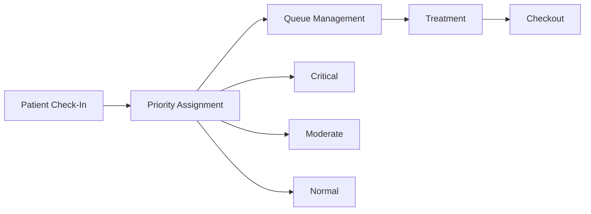

# 🏥 Hospital Queue Manager

<div align="center">


**Patient Queue Management with Priority Levels**

[]()
[](https://github.com/samalarakshithbabu/hospital-queue-manager/issues)

</div>

---

## 🚀 Executive Summary

A **simple hospital queue management web application** to register patients, prioritize them based on emergency level, and manage check-ins and check-outs efficiently.

### What It Does



---

## ✨ Key Features

| Feature | Description |
|---------|-------------|
| **Patient Check-In** | Name, emergency level, symptoms |
| **Queue Display** | Table view of current patients |
| **Priority Levels** | Critical, Moderate, Normal |
| **Checkout** | Remove patients after treatment |
| **Modular JS** | Reusable counter module |

---

## 🛠️ Technology Stack

| Component | Technology | Purpose |
|-----------|------------|---------|
| **Frontend** | HTML, CSS, Vanilla JS | UI |
| **Backend** | Node.js API | Data handling |
| **Modules** | Modular JavaScript | Code organization |

---

## 📁 Project Structure

```
hospital-queue-manager/
├── index.html       # Main HTML page
├── style.css        # Styling
├── main.js          # Core logic
├── counter.js       # Reusable counter module
├── server.js        # Backend server
├── package.json     # Node.js dependencies
└── README.md
```

---

## 🛠️ Installation

### Prerequisites
- Node.js 14+
- npm

### Setup
```bash
npm install
node server.js
# Expects API at http://localhost:3000
```

---

## ⚠️ Limitations

| Limitation | Description |
|------------|-------------|
| **Backend API** | Assumes external API |
| **Database** | No persistence (in-memory) |
| **Authentication** | No user auth |

---

## 📄 License

This project is licensed under the MIT License.

---

## 👨‍💻 Author

**SAMALA RAKSHITH BABU**

- 📧 Email: samalarakshithbabu7@gmail.com
- 💼 LinkedIn: [samala-rakshith-babu](https://www.linkedin.com/in/samala-rakshith-babu/)
- 🐙 GitHub: [samalarakshithbabu](https://github.com/samalarakshithbabu)